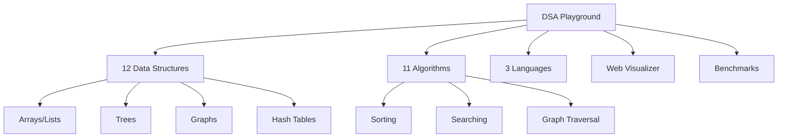

# 🚀 DSA Playground - Interactive Data Structures & Algorithms

<div align="center">


**Complete DSA Implementation with Interactive Web Visualizer**

[]()
[](https://github.com/samalarakshithbabu/dsa-playground/issues)

</div>

---

## 🚀 Executive Summary

A **comprehensive collection of Data Structures and Algorithms** implemented in C, Java, and Python with an interactive web-based visualization interface. Perfect for learning, practicing, and comparing algorithm performance across languages.

### What It Does



---

## 📊 Data Structures Implemented

| Data Structure | C | Java | Python |
|----------------|---|------|--------|
| **Array / Dynamic Array** | ✅ | ✅ | ✅ |
| **Singly Linked List** | ✅ | ✅ | ✅ |
| **Doubly Linked List** | ✅ | ✅ | ✅ |
| **Stack** | ✅ | ✅ | ✅ |
| **Queue / Circular Queue** | ✅ | ✅ | ✅ |
| **Binary Search Tree** | ✅ | ✅ | ✅ |
| **AVL Tree** | ✅ | ✅ | ✅ |
| **Red-Black Tree** | ✅ | ✅ | ✅ |
| **Heap (Min/Max)** | ✅ | ✅ | ✅ |
| **Hash Table** | ✅ | ✅ | ✅ |
| **Graph (Adj/List/Matrix)** | ✅ | ✅ | ✅ |
| **Trie** | ✅ | ✅ | ✅ |

---

## 🔢 Algorithms Implemented

| Algorithm | C | Java | Python |
|-----------|---|------|--------|
| **Bubble Sort** | ✅ | ✅ | ✅ |
| **Merge Sort** | ✅ | ✅ | ✅ |
| **Quick Sort** | ✅ | ✅ | ✅ |
| **Heap Sort** | ✅ | ✅ | ✅ |
| **Binary Search** | ✅ | ✅ | ✅ |
| **DFS** | ✅ | ✅ | ✅ |
| **BFS** | ✅ | ✅ | ✅ |
| **Dijkstra's Algorithm** | ✅ | ✅ | ✅ |
| **A* Search** | ✅ | ✅ | ✅ |
| **Kruskal's MST** | ✅ | ✅ | ✅ |
| **Prim's MST** | ✅ | ✅ | ✅ |

---

## 🛠️ Technology Stack

| Layer | Technology | Purpose |
|-------|------------|---------|
| **Web Frontend** | React + TypeScript | Interactive visualizer |
| **Build Tool** | Vite | Fast development |
| **C Implementations** | GCC + Make | Native code |
| **Java** | Maven | Project management |
| **Python** | pip + pytest | Script implementations |

---

## 📁 Project Structure

```
dsa-playground/
├── c/                          # C implementations
│   ├── include/               # Header files
│   ├── src/                   # Source files
│   ├── tests/                 # Unit tests
│   └── Makefile
├── java/                       # Java implementations
│   ├── src/
│   │   ├── datastructures/
│   │   ├── algorithms/
│   │   └── utils/
│   ├── test/
│   └── pom.xml
├── python/                     # Python implementations
│   ├── datastructures/
│   ├── algorithms/
│   ├── tests/
│   └── requirements.txt
├── web/                        # Interactive web visualizer
│   ├── src/
│   │   ├── components/
│   │   ├── pages/
│   │   └── utils/
│   ├── package.json
│   └── vite.config.ts
├── benchmarks/                 # Performance benchmarks
├── docs/                       # Documentation
├── README.md
└── LICENSE
```

---

## 🛠️ Installation

### Quick Start
```bash
# Clone repository
git clone https://github.com/samalarakshithbabu/dsa-playground.git
cd dsa-playground
```

### Web Visualizer
```bash
cd web
npm install
npm run dev
# Opens at http://localhost:5173
```

### Python
```bash
cd python
pip install -r requirements.txt
python -m datastructures.demo
pytest tests/
```

### Java
```bash
cd java
mvn compile
mvn exec:java -Dexec.mainClass="com.dsa.Main"
mvn test
```

### C
```bash
cd c
make
./bin/dsa_demo
make test
```

---

## 🎨 Web Visualizer Features

| Feature | Description |
|---------|-------------|
| **Step-by-Step Execution** | Interactive algorithm visualization |
| **Data Structure Operations** | Visual representation of inserts/deletes |
| **Complexity Analysis** | Time & space complexity display |
| **Multi-Language Code** | Syntax highlighting for C, Java, Python |
| **Theme Support** | Dark/Light mode |

---

## 📈 Benchmarks

Run performance comparisons across languages:
```bash
cd benchmarks
python run_benchmarks.py
```

Results show relative performance for each algorithm implementation.

---

## 📚 Educational Features

Each implementation includes:
- Time and space complexity annotations
- Inline comments explaining key steps
- Unit tests verifying correctness
- Example usage in demo files

---

## 📄 License

This project is licensed under the MIT License.

---

## 👨‍💻 Author

**SAMALA RAKSHITH BABU**

- 📧 Email: samalarakshithbabu7@gmail.com
- 💼 LinkedIn: [samala-rakshith-babu](https://www.linkedin.com/in/samala-rakshith-babu/)
- 🐙 GitHub: [samalarakshithbabu](https://github.com/samalarakshithbabu)

---

<div align="center">

**Built with ❤️ for Computer Science Education**

</div>